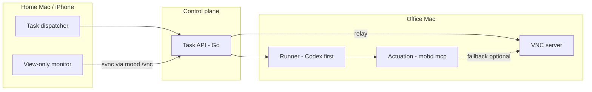

# MOB


Intranet-deployable remote office agent: an AI agent runs on an **office Mac**, while a **home Mac** and **iPhone** act as a task dispatcher and view-only monitor.

MOB is a private alternative shape to cloud desktop agents (e.g. Manus, Grok Bot). The desktop stays in the office; clients do not host the agent runtime.

## Current status

**Phase 1 + lite client scaffold.** Docs under [`docs/`](docs/). Control plane and actuation: Go **`mobd`** — [`cmd/mobd`](cmd/mobd) (actuation is the built-in `mobd mcp` server). Home App: Tauri **`apps/mob`** — [`apps/mob/README.md`](apps/mob/README.md).

## Relationship to svnc

Screen viewing uses the VNC protocol. The human-facing viewer is the sibling project **[svnc](https://github.com/xrdavies/svnc)** (Simple VNC, MIT, npm package `@xrdavies/svnc`). Human sessions connect in **viewOnly** mode.

Human input is an explicit **Control** mode in the full-size live view of [`apps/mob`](apps/mob/README.md); the thumbnail and the default full-size view stay view-only.

MOB owns task dispatch, the office runner, and the client shell that embeds svnc. Actuation prefers an in-repo local computer-use MCP (**`mob-mcp`**, [ADR 0007](docs/adr/0007-actuation-mob-mcp.md); built into the `mobd` binary as `mobd mcp` per [ADR 0008](docs/adr/0008-actuation-in-mobd.md)) and stays separate from the human viewOnly VNC session.

## High-level architecture



| Layer | Role |
| --- | --- |
| Client | Chat / dispatch tasks; embed or open svnc as monitor |
| Control plane | Thin task API owned by MOB — **Go** (`mobd`) |
| Office runner | **Codex** (default) and **Claude Code**; pluggable interface for others |
| Actuation | **`mob-mcp`** tools served by `mobd mcp` (local stdio MCP, Go, MIT); third-party MCPs optional after license review; svnc Automation as fallback |
| View | VNC + svnc; later protocols behind a `DesktopView` abstraction |

## Common tasks

A `Makefile` wraps the usual commands; run `make` to list them.

```bash
make build        # bin/mobd
make init         # create ~/.mobd/config.json once; configure the LAN bind
make start        # run mobd on the office Mac (logs: make logs)
make app-desktop  # home App as a desktop window (app-install once)
make check        # Go vet + tests, App tests + typecheck
```

End users configure `~/.mobd/config.json` and run `mobd start` directly. See
[`config.example.json`](config.example.json) and the
[JSON setup instructions](cmd/mobd/README.md#json-configuration-recommended-for-end-users).

**Developers only:** to configure mobd through environment variables, copy the root
[`.env.example`](.env.example) to `.env` and follow the
[environment startup instructions](cmd/mobd/README.md#environment-variables-developers-only).
The shell must export the variables before running `make start` or `make serve`.

## Docs

- [Public R2 downloads, signing, installer and Tauri updates](docs/releases.md)
- [Screen Buddy logo and app icons](docs/brand/README.md)
- [Architecture](docs/architecture.md)
- [Computer-use research](docs/research-computer-use.md)
- [Phase 1 implementation plan](docs/implementation-phase1.md)
- [Office Mac smoke checklist](docs/office-smoke-checklist.md)
- [Office smoke test report](docs/office-smoke-test-report.md)
- [VNC + svnc viewOnly setup](docs/vnc-svnc-setup.md)
- [mobd CLI and configuration](cmd/mobd/README.md)
- [Runners (agent CLIs)](docs/runners.md)
- [Roadmap](docs/roadmap.md)
- [Phase 2 lite home App `apps/mob` (embed svnc)](docs/client-phase2-lite.md)
- [apps/mob UI design (v2)](docs/apps-mob-ui.md)
- [mobd v3 features and API design](docs/mobd-v3.md)
- [Security notes](docs/security.md)
- ADRs:
  - [0001 — Screen view: VNC + svnc](docs/adr/0001-screen-view-vnc-svnc.md)
  - [0002 — Orchestration: thin custom stack](docs/adr/0002-orchestration-thin-custom.md)
  - [0003 — Actuation: local MCP](docs/adr/0003-actuation-local-mcp.md)
  - [0004 — Runner: Codex first](docs/adr/0004-runner-codex-first.md)
  - [0005 — Backend: Go](docs/adr/0005-backend-go.md)
  - [0006 — Actuation: ControlMCP first](docs/adr/0006-actuation-controlmcp-first.md) (**superseded**)
  - [0007 — Actuation: in-repo mob-mcp](docs/adr/0007-actuation-mob-mcp.md) (language **superseded** by 0008)
  - [0008 — Actuation: merge mob-mcp into mobd (Go)](docs/adr/0008-actuation-in-mobd.md)
  - [0009 — Home App frontend: React + Tailwind + shadcn/ui](docs/adr/0009-app-frontend-react.md)
  - [0010 — VNC WebSocket relay in mobd](docs/adr/0010-vnc-relay-in-mobd.md)

## License

[MIT](LICENSE)
