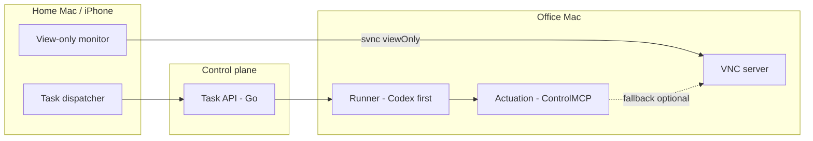

# MOB

Intranet-deployable remote office agent: an AI agent runs on an **office Mac**, while a **home Mac** and **iPhone** act as a task dispatcher and view-only monitor.

MOB is a private alternative shape to cloud desktop agents (e.g. Manus, Grok Bot). The desktop stays in the office; clients do not host the agent runtime.

## Current status

**Design docs.** Architecture, ADRs, roadmap, and the [Phase 1 implementation plan](docs/implementation-phase1.md) (**Go** control plane / runner host + **ControlMCP** + Codex + svnc viewOnly) live under [`docs/`](docs/). No application runtime is shipped in this repository yet.

## Relationship to svnc

Screen viewing uses the VNC protocol. The human-facing viewer is the sibling project **[svnc](https://github.com/xrdavies/svnc)** (Simple VNC, MIT, npm package `svnc`). Human sessions connect in **viewOnly** mode.

MOB owns task dispatch, the office runner, and the client shell that embeds svnc. Actuation (opening apps, clicking UI) prefers local computer-use MCP on the office Mac (**ControlMCP** first) and stays separate from the human viewOnly VNC session.

## High-level architecture

| Layer | Role |
| --- | --- |
| Client | Chat / dispatch tasks; embed or open svnc as monitor |
| Control plane | Thin task API owned by MOB — **Go** (`mobd`) |
| Office runner | Starts with **Codex**; Claude / Grok pluggable later |
| Actuation | **ControlMCP** first (local MCP); GhostDesk later via config; svnc Automation as fallback |
| View | VNC + svnc; later protocols behind a `DesktopView` abstraction |

## Docs

- [Architecture](docs/architecture.md)
- [Phase 1 implementation plan](docs/implementation-phase1.md)
- [Office Mac smoke checklist](docs/office-smoke-checklist.md)
- [Roadmap](docs/roadmap.md)
- [Security notes](docs/security.md)
- ADRs:
  - [0001 — Screen view: VNC + svnc](docs/adr/0001-screen-view-vnc-svnc.md)
  - [0002 — Orchestration: thin custom stack](docs/adr/0002-orchestration-thin-custom.md)
  - [0003 — Actuation: local MCP](docs/adr/0003-actuation-local-mcp.md)
  - [0004 — Runner: Codex first](docs/adr/0004-runner-codex-first.md)
  - [0005 — Backend: Go](docs/adr/0005-backend-go.md)
  - [0006 — Actuation: ControlMCP first](docs/adr/0006-actuation-controlmcp-first.md)

## License

[MIT](LICENSE)
