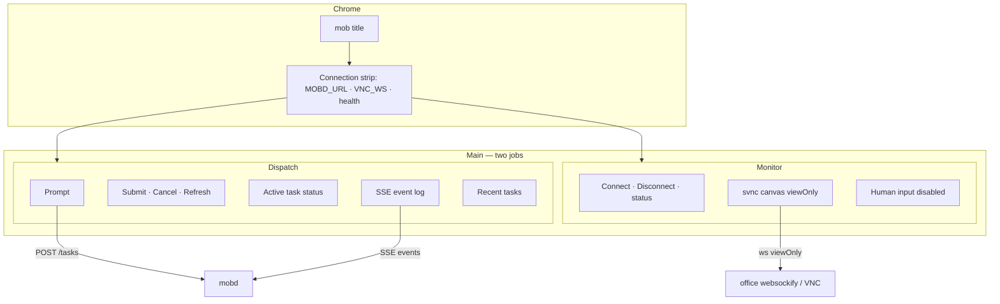
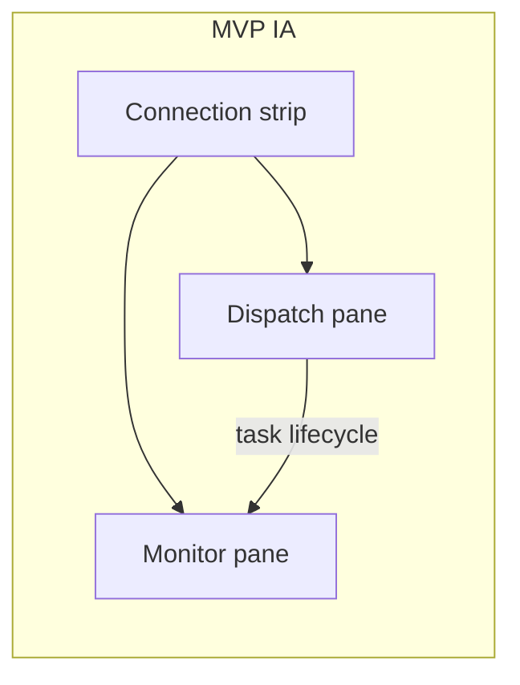
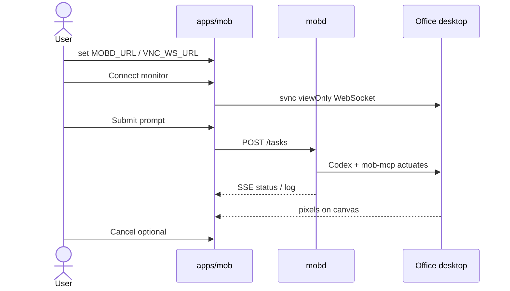

# apps/mob — UI plan (continuous improvement)

**Product:** home Mac **mob** App = **remote control (dispatch)** + **viewOnly monitor**.  
**Stack:** Tauri 2 + Vite/TS; embed [svnc](https://github.com/xrdavies/svnc).  
**Auth:** none yet (intranet / VPN only). See [client-phase2-lite.md](client-phase2-lite.md).

This doc is the living UI target. Scaffold lives in [`apps/mob`](../apps/mob); iterate toward MVP → polish without changing the two-job IA.

---

## Product jobs (information architecture)

| Job | User need | Surfaces | System |
| --- | --- | --- | --- |
| **Dispatch** | Tell office Codex what to do; watch progress; cancel | Prompt, Submit/Cancel, task meta, SSE log, recent list | `MOBD_URL` → `mobd` HTTP/SSE |
| **Monitor** | See office desktop while Agent works; **never** drive UI yourself | Live canvas, Connect/Disconnect, viewOnly badge | `VNC_WS_URL` → websockify → VNC via svnc `viewOnly: true` |

Hard rules for every iteration:

1. **One window, two primary regions** — Dispatch (left / top) and Monitor (right / bottom). Connection settings are supporting chrome, not a third “app mode.”
2. **Human input stays off** on the monitor — badge + copy always say viewOnly; never wire mouse/keyboard to RFB.
3. **No auth UI** until a later Phase 2 slice — no login screen, no token fields in MVP.
4. **Config is prefills + editable** — `MOBD_URL` / `VNC_WS_URL` from env; user can override in-session (persist locally later).



---

## Screen map (MVP)

Single route. No tabs, no settings page yet.

```text
┌─────────────────────────────────────────────────────────────────┐
│  mob          dispatch + viewOnly monitor     [health ●] [vnc ●]│
├─────────────────────────────────────────────────────────────────┤
│  MOBD_URL […………]  VNC_WS_URL […………]  password [··]  [Ping]     │
├──────────────────────────────┬──────────────────────────────────┤
│  DISPATCH                    │  LIVE VIEW  ⌈viewOnly⌋           │
│  ┌────────────────────────┐  │  [Connect] [Disconnect]  status  │
│  │ prompt textarea        │  │  ┌────────────────────────────┐  │
│  └────────────────────────┘  │  │                            │  │
│  [Submit] [Cancel] [Refresh] │  │   svnc canvas (black)      │  │
│  id · status · runner        │  │                            │  │
│  ┌ SSE log ───────────────┐  │  └────────────────────────────┘  │
│  │ …                      │  │  Human input disabled · Agent    │
│  └────────────────────────┘  │  actuates via mob-mcp            │
│  Recent                      │                                  │
│  · abc123…  running          │                                  │
│  · def456…  succeeded        │                                  │
└──────────────────────────────┴──────────────────────────────────┘
```

Narrow / short window: stack Dispatch above Monitor (already in CSS `@media`).



User flow (happy path):



---

## Component inventory (current → target)

| Area | Now (scaffold) | Keep / change |
| --- | --- | --- |
| Header | Title + tagline | Add compact **office** + **VNC** status dots in header |
| Connection strip | Three fields + Ping | Keep; collapse/advanced later; localStorage persist |
| Prompt | Textarea | Keep; Cmd/Ctrl+Enter to submit |
| Task actions | Submit / Cancel / Refresh | Keep labels; primary = Submit |
| Task meta | Plain text | Status **pill** (queued / running / …) |
| Event log | `<pre>` | Keep; clearer empty state |
| Recent list | id slice + status | Highlight active; show short prompt snippet |
| Monitor chrome | Connect / Disconnect + badge | Keep viewOnly badge prominent |
| Screen | `#screen` + stub | Empty state when disconnected; fill height |
| Copy | Hint under canvas | Keep “human input disabled” |

---

## MVP vs next polish

### MVP (ship / verify with office)

- [x] Two-pane layout: dispatch + monitor  
- [x] Prefill + edit `MOBD_URL`, `VNC_WS_URL`, optional VNC password  
- [x] `POST /tasks`, cancel, list, SSE subscribe  
- [x] svnc connect with **`viewOnly: true`** only  
- [x] Health ping (`GET /health`)  
- [ ] Header status indicators + clearer empty states *(this polish pass)*  
- [ ] Cmd/Ctrl+Enter submit; persist URLs in `localStorage` *(this polish pass)*  
- [ ] Active task highlight in Recent *(this polish pass)*  
- [ ] Status color pills on meta + list *(this polish pass)*  
- CORS on `mobd` if browser blocks (office follow-up, not App UI)  
- End-to-end: home Submit → office UI moves → canvas updates  

**Out of MVP:** auth/login, chat history DB, multi-window, human remote input, iPhone layout pass, settings modal, dark/light toggle (dark-only OK).

### Next polish (continuous improvement)

| Slice | Idea |
| --- | --- |
| **Connection** | Collapse strip behind “Connection”; remember last URLs; optional “Use health.vncViewUrl” helper text |
| **Dispatch** | Prompt templates / recent prompts; truncate long SSE lines; auto-scroll lock toggle |
| **Monitor** | Fit-to-window / 1:1 zoom; reconnect backoff; show desktop WxH always |
| **Feedback** | Toast on create/fail; copy task id; relative timestamps |
| **Layout** | Resizable split pane; remember pane widths |
| **Auth (later)** | Login / shared secret field — **not before** product asks for App auth |
| **Mobile** | Separate pass; same IA, stacked panes first |

---

## Visual language (light guidance)

- Dark shell (current tokens): `--bg`, `--panel`, `--accent`, `--ok`, `--danger`.  
- **Status pills:** queued=muted, running=accent, succeeded=ok, failed/cancelled=danger/muted.  
- Monitor canvas always near-black; don’t put busy chrome over the stream.  
- Primary action: **Submit** (accent). Destructive: **Cancel**. Secondary: Ping / Refresh / Disconnect.  
- Typography: system UI; log monospace small.

---

## Accessibility & safety notes

- Monitor remains non-interactive for RFB; `tabindex="-1"` on screen is fine.  
- SSE log: `aria-live="polite"` already — keep.  
- Never store VNC password in the repo; local session / later keychain only.  
- Do not add “Enable control” in MVP polish — that is an explicit future feature with confirmation UX.

---

## Implementation pointers

| File | Role |
| --- | --- |
| [`apps/mob/index.html`](../apps/mob/index.html) | Structure: header, config, panes |
| [`apps/mob/src/styles.css`](../apps/mob/src/styles.css) | Layout + tokens |
| [`apps/mob/src/main.ts`](../apps/mob/src/main.ts) | mobd + svnc wiring |
| [`apps/mob/README.md`](../apps/mob/README.md) | Run / env |

When changing UI, update this doc’s MVP checklist and wireframe if IA shifts.

## References

- [client-phase2-lite.md](client-phase2-lite.md)  
- [vnc-svnc-setup.md](vnc-svnc-setup.md)  
- [architecture.md](architecture.md)  
- [cmd/mobd/README.md](../cmd/mobd/README.md)  
