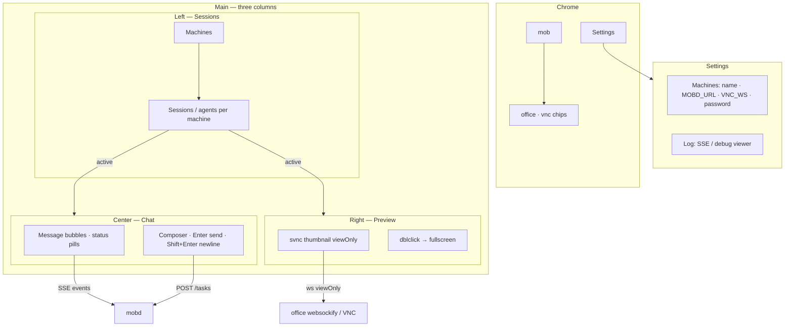
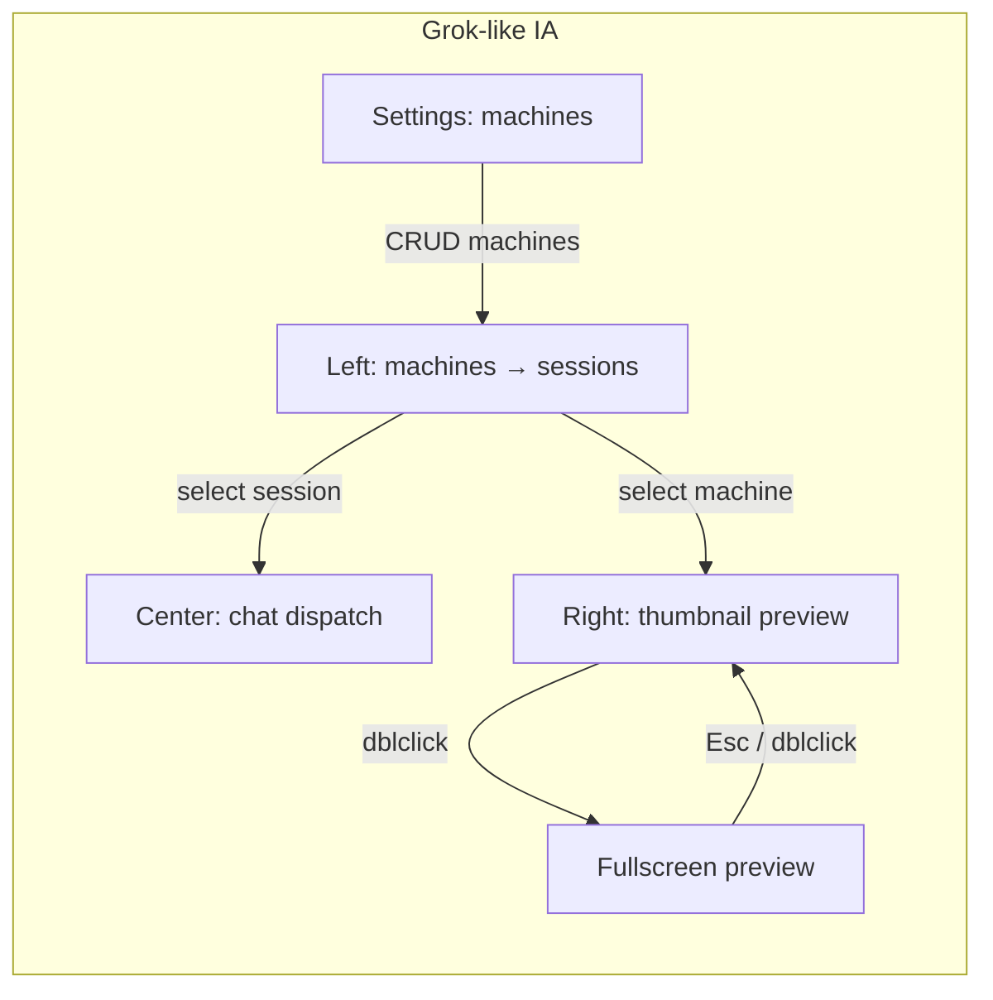
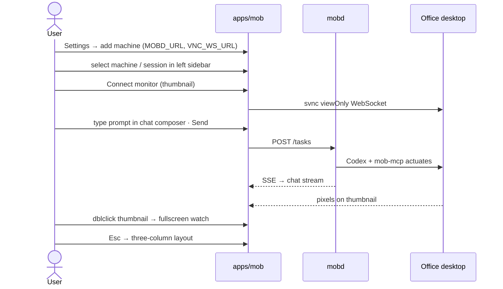

# apps/mob — UI plan (continuous improvement)

**Product:** home Mac **mob** App = **remote control (dispatch)** + **viewOnly monitor**.  
**Stack:** Tauri 2 + Vite/TS; embed [svnc](https://github.com/xrdavies/svnc).  
**Auth:** none yet (intranet / VPN only). See [client-phase2-lite.md](client-phase2-lite.md).

This doc is the living UI target. Scaffold lives in [`apps/mob`](../apps/mob). IA mirrors a Grok Bot–style shell: **left sessions · center chat · right screen thumbnail**, with Settings for remote machines.

---

## Product jobs (information architecture)

| Job | User need | Surfaces | System |
| --- | --- | --- | --- |
| **Sessions** | Pick a remote machine and a session/agent under it | Left sidebar: machines → nested sessions | localStorage machines; later multi-`mobd` |
| **Dispatch** | Chat-style: tell office Codex what to do; watch progress; cancel | Center: message/SSE stream + prompt composer | Active machine’s `MOBD_URL` → `mobd` HTTP/SSE |
| **Monitor** | See office desktop while Agent works; **never** drive UI yourself | Right thumbnail preview; double-click → App-fullscreen | Active machine’s `VNC_WS_URL` → websockify → VNC via svnc `viewOnly: true` |
| **Settings** | Add/edit remote machines (connection info) | Settings overlay/view — not main chrome | Persisted in localStorage |

Hard rules for every iteration:

1. **Three-column shell** — Left sessions (by machine), center chat dispatch, right viewOnly thumbnail. Connection fields live in **Settings**, not a permanent strip.
2. **Human input stays off** on the monitor — badge + copy always say viewOnly; never wire mouse/keyboard to RFB.
3. **No auth UI** until a later Phase 2 slice — no login screen, no token fields in MVP.
4. **Machines are first-class** — each has display name, `MOBD_URL`, `VNC_WS_URL`, optional VNC password; env values only prefill a default machine.
5. **Thumbnail ↔ fullscreen** — right pane shows a shrunk preview; double-click expands to fill the App; Esc / double-click again returns to the three-column layout. Still always `viewOnly: true`.



---

## Screen map (Grok-like)

### Default: three columns

```text
┌──────────────────────────────────────────────────────────────────────────┐
│  mob     office ● ok    vnc ● on                    [Settings]           │
├────────────┬───────────────────────────────┬─────────────────────────────┤
│ SESSIONS   │  CHAT                         │  LIVE VIEW ⌈viewOnly⌋       │
│            │                               │  [Connect] [Disconnect]     │
│ ▼ Office-A │  · system: subscribed abc…    │  ┌───────────────────────┐  │
│   · sess 1 │  · status: running            │  │                       │  │
│   · sess 2 │  · log: opening Safari…       │  │  thumbnail (shrunk)   │  │
│ ▶ Office-B │                               │  │  dblclick → expand    │  │
│   · …      │                               │  │                       │  │
│            │                               │  └───────────────────────┘  │
│ + machine  │  ┌─────────────────────────┐  │  Human input disabled       │
│  (Settings)│  │ prompt…          [Send] │  │                             │
│            │  └─────────────────────────┘  │                             │
└────────────┴───────────────────────────────┴─────────────────────────────┘
```

### Expanded: fullscreen preview

```text
┌──────────────────────────────────────────────────────────────────────────┐
│  mob · Live view ⌈viewOnly⌋ · office ● · vnc ●     Esc / dblclick back  │
├──────────────────────────────────────────────────────────────────────────┤
│                                                                          │
│                     svnc canvas fills the App                            │
│                     (still viewOnly — no RFB input)                      │
│                                                                          │
└──────────────────────────────────────────────────────────────────────────┘
```

Narrow / short window: stack columns (sessions collapse or drawer; chat above thumbnail). Fullscreen preview still fills the App.



User flow (happy path):



---

## Machines & sessions

| Concept | Meaning | Persistence |
| --- | --- | --- |
| **Machine** | Named remote office host: `MOBD_URL`, `VNC_WS_URL`, optional VNC password | `localStorage` (`mob.machines`) |
| **Session / agent** | A dispatch context under a machine (MVP: one “default” session per machine + recent tasks as session-like rows; later multi-agent) | UI state + task list from `GET /tasks` |
| **Active selection** | Which machine’s URLs drive fetch/SSE/svnc; which session’s stream is shown in chat | In-memory + last-selected id in localStorage |

MVP can keep a single live `mobd` endpoint per selected machine. Multi-machine is local list + switch active; no server-side session sync yet.

---

## Settings

- Opened from header **Settings** (overlay or dedicated view).
- Tabs: **Machines** | **Log**.
- **Machines:** list; add / edit / remove. Fields: **display name**, **MOBD_URL**, **VNC_WS_URL**, **VNC password** (optional; session-only / localStorage — never in repo). Ping `/health` for the selected or edited machine.
- **Log:** scrollable SSE / debug viewer (filter + clear). Raw status/stderr/stdout/codex noise lives here — **not** in the chat transcript.
- Closing Settings returns to the three-column shell; connection strip is **gone** from main chrome.

---

## Preview interaction

| State | Behavior |
| --- | --- |
| **Thumbnail** | Right column; CSS shrink / `object-fit` so the screen fits a narrow pane; Connect / Disconnect / viewOnly badge stay visible |
| **Fullscreen** | Overlay (or body class) fills the App; same `#screen` / svnc client — reconnect not required on expand |
| **Enter** | Double-click thumbnail (or canvas) |
| **Exit** | Escape, or double-click again, or an explicit “Back” control |
| **Hard rule** | Always `viewOnly: true` in both states |

---

## Component inventory (current → target)

| Area | Now (two-pane + strip) | Target (Grok-like) |
| --- | --- | --- |
| Header | Title + status chips | Keep chips; add **Settings**; drop connection strip |
| Connection strip | Three fields + Ping | **Remove** from main; move into Settings machine form |
| Left sidebar | — | Machines grouped; nested sessions/tasks; select active |
| Center chat | Form-ish Dispatch pane | **Bubbles** (user + assistant) + compact status pills; composer **Enter=send**, **Shift+Enter=newline**; Cancel when active |
| Task meta / Recent | Meta + list under form | Fold into chat stream + left session rows |
| Right preview | Full half-pane Live view | **Thumbnail**; dblclick → fullscreen |
| Monitor chrome | Connect / Disconnect + badge | Keep on thumbnail header; badge in fullscreen chrome too |
| Settings | — | Overlay tabs: **Machines** (CRUD + Ping) · **Log** (SSE/debug) |
| Screen | `#screen` + stub | Same element; CSS modes `thumbnail` / `fullscreen` |

---

## MVP vs next polish

### MVP (this IA pass)

- [x] Dispatch + viewOnly monitor (prior scaffold)
- [x] Prefill URLs from env; persist locally
- [x] `POST /tasks`, cancel, list, SSE subscribe
- [x] svnc `viewOnly: true` only
- [x] **Three-column shell** + Settings overlay
- [x] **Machines** in localStorage; left sidebar grouped by machine
- [x] **Chat-style** center (stream + composer)
- [x] **Thumbnail** right pane; **dblclick ↔ fullscreen** (Esc to exit)
- [x] Connection fields only in Settings (not main chrome)
- [x] Chat **bubbles** (not raw SSE dump); Settings → **Log** for debug
- [x] Composer: Enter send · Shift+Enter newline; normalize `GET /tasks` `{tasks:[]}`
- CORS on `mobd` if browser blocks (office follow-up)
- End-to-end: home Send → office UI moves → canvas updates

**Out of MVP:** auth/login, chat history DB, multi-window, human remote input, real multi-agent server sessions, iPhone layout pass, light theme.

### Next polish

| Slice | Idea |
| --- | --- |
| **Machines** | Import from `.env`; “Use health.vncViewUrl”; validate URLs |
| **Sessions** | Named agents per machine; pin / archive |
| **Chat** | Prompt templates; auto-scroll lock; relative timestamps; copy task id |
| **Monitor** | Fit / 1:1 zoom; reconnect backoff; show desktop WxH |
| **Layout** | Resizable column widths; remember layout; sessions drawer on narrow |
| **Auth (later)** | Login / shared secret — **not before** product asks |
| **Mobile** | Stacked columns; fullscreen preview first-class |

---

## Visual language (light guidance)

- Dark shell (current tokens): `--bg`, `--panel`, `--accent`, `--ok`, `--danger`.
- **Status pills:** queued=muted, running=accent, succeeded=ok, failed/cancelled=danger/muted.
- Thumbnail canvas near-black; fullscreen chrome minimal so the stream dominates.
- Primary action: **Send** in composer (accent). Destructive: **Cancel**. Secondary: Connect / Disconnect / Ping in Settings.
- Typography: system UI for chat bubbles; Settings Log is monospace for SSE lines.

---

## Accessibility & safety notes

- Monitor remains non-interactive for RFB; `tabindex="-1"` on screen is fine.
- Fullscreen exit via Esc must work; focus trap optional for MVP.
- SSE / chat stream: `aria-live="polite"`.
- Never store VNC password in the repo; local session / later keychain only.
- Do not add “Enable control” in MVP — explicit future feature with confirmation UX.

---

## Implementation pointers

| File | Role |
| --- | --- |
| [`apps/mob/index.html`](../apps/mob/index.html) | Shell: header, sidebar, chat, preview, settings, fullscreen |
| [`apps/mob/src/styles.css`](../apps/mob/src/styles.css) | Three-column grid, thumbnail, fullscreen overlay, tokens |
| [`apps/mob/src/main.ts`](../apps/mob/src/main.ts) | Machines localStorage, chat stream, mobd + svnc, expand/collapse |
| [`apps/mob/README.md`](../apps/mob/README.md) | Run / env |

When changing UI, update this doc’s MVP checklist and wireframe if IA shifts.

## References

- [client-phase2-lite.md](client-phase2-lite.md)  
- [vnc-svnc-setup.md](vnc-svnc-setup.md)  
- [architecture.md](architecture.md)  
- [cmd/mobd/README.md](../cmd/mobd/README.md)  
