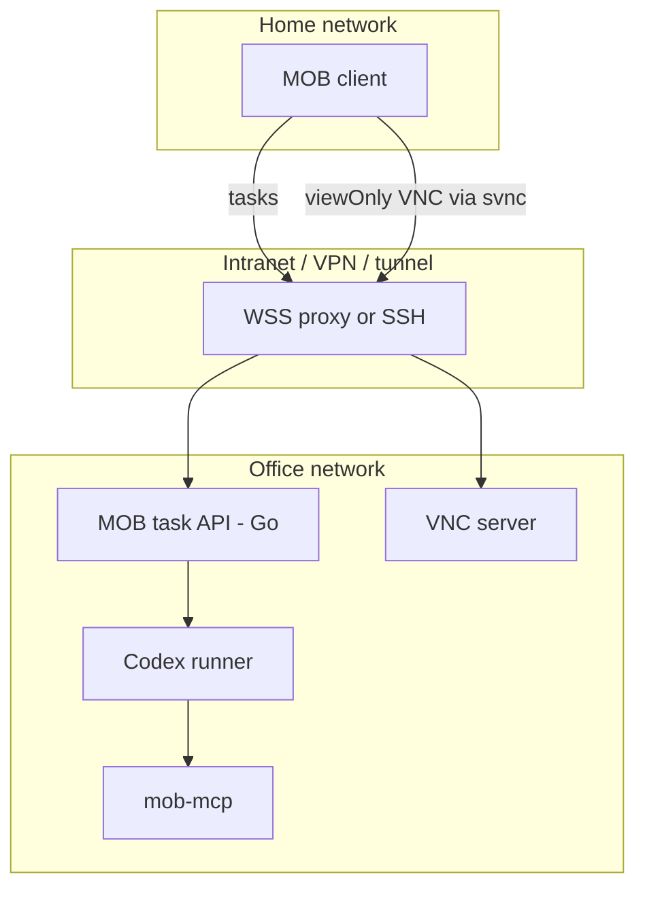

# Architecture

MOB splits **control** (what the agent should do) from **view** (what the human sees) and from **actuation** (how the agent drives the office Mac UI).

## Components

### Client (dispatcher + monitor)

Runs on the home Mac and iPhone.

- **Dispatcher:** send tasks, watch task status, converse with the office agent session.
- **Monitor:** view the office desktop in real time. Humans are **view-only** by default (no mouse/keyboard forwarding). Phase 1 may open the viewer in a separate window; later the viewer embeds inside MOB clients via svnc.

Clients are a remote control + monitor, not the place where the agent runtime lives.

### Control plane (task API)

Thin HTTP/API layer owned by MOB, implemented in **Go** as `mobd` (see [ADR 0005](adr/0005-backend-go.md) and [Phase 1 plan](implementation-phase1.md)):

- create / list / cancel tasks
- attach a runner session (Codex first)
- stream or poll status (SSE)
- (later) human approval gates for sensitive actions

MOB learns UX concepts from tools like Paseo / Orca (remote start of coding agents, task state) but does **not** fork those projects. See [ADR 0002](adr/0002-orchestration-thin-custom.md).

### Office runner (Codex first)

Process(es) on the office Mac that:

- receive a task from the control plane
- start or attach a **Codex** session with the configured computer-use / MCP tools
- report progress back to the control plane

The runner host is part of the same **Go** binary boundary as the control plane in Phase 1. Claude, Grok, and others are intended as later pluggable runners behind the same interface. See [ADR 0004](adr/0004-runner-codex-first.md).

### Actuation (local MCP)

How the agent opens apps and operates the GUI on the office Mac.

- **Phase 1 preferred:** in-repo [`services/mob-mcp`](../services/mob-mcp/) on the office machine, with macOS Accessibility + Screen Recording. See [ADR 0007](adr/0007-actuation-mob-mcp.md) and [research-computer-use.md](research-computer-use.md).
- **Later optional:** other local MCP servers via configuration **after license review** (GhostDesk FSL Competing Use is a poor fit to ship as MOB’s core; see research).
- **Fallback:** svnc Automation (click / type over VNC), on a path separate from the human viewOnly session.

See [ADR 0003](adr/0003-actuation-local-mcp.md).

### View (VNC + svnc)

- Office Mac runs a VNC server exposing the desktop.
- Humans connect with **[svnc](https://github.com/xrdavies/svnc)** in `viewOnly: true`.
- Transport: prefer intranet / VPN; use WSS reverse proxy or SSH as documented for svnc peripherals (not VeNCrypt).

See [ADR 0001](adr/0001-screen-view-vnc-svnc.md) and [security](security.md).

### DesktopView interface

Monitor implementations should sit behind a small abstraction (name: `DesktopView`) so the client depends on “show office desktop,” not on raw VNC forever.

- **Default implementation:** VNC via svnc
- **Later candidates:** WebRTC + ScreenCaptureKit (macOS), other protocols

Actuation APIs are **not** part of `DesktopView`. Viewing and driving stay separate.

## Trust and network sketch

Sensitive operations (payments, credentials) should eventually require explicit human approval in the control plane; not required for Phase 1 scaffolding.
