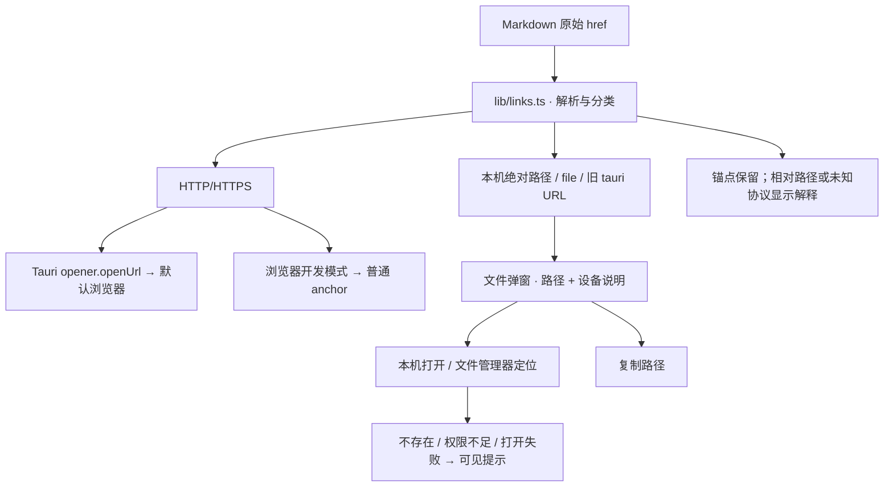

# Issue #2：聊天回复链接的打开行为

状态：已按确认方案实现，等待人工验收。
基线：`a9b9b2a`，2026-10-28。
Issue：[bug: 聊天回复中的外部链接和本地文件链接点击无反应](https://github.com/xrdavies/mob/issues/2)。
代码导航：[模块与数据流图](../code-map.md)。

## 已验证的事实与验证边界

1. [Markdown.tsx](../../src/components/timeline/Markdown.tsx) 对所有链接统一输出
   `<a href={href} target="_blank" rel="noreferrer">`，没有点击分发与错误提示。
2. Rust 入口、Cargo/npm 依赖和 capabilities 均未接入 opener；没有自定义
   `on_new_window` 处理。本项目尚无“在系统浏览器打开聊天链接”的显式路径。
3. 使用 Vite 的 `transformWithOxc` 在内存中加载**实际 Markdown 组件**，再通过
   React `renderToStaticMarkup` 验证 issue 三种输入，得到：

   | Markdown 目标 | 组件实际输出 |
   | --- | --- |
   | issue 中 Apple HTTPS 地址 | `href="https://developer.apple.com/..." target="_blank"` |
   | `/Users/m4003/dev/github/xrdavies/build-results/mob-ios-build-check.log` | 保持绝对路径；以 `tauri://localhost` 为基址解析后，恰好得到 issue 的 URL |
   | `tauri://localhost/Users/m4003/dev/github/xrdavies/build-results/mob-ios-build-check.log` | `href=""`，被 react-markdown 默认 URL 策略过滤 |

   这验证了真实组件的输出与路径解析，**没有验证系统浏览器是否实际启动**。
   一次性探针检查“存在显式点击动作”的断言对三种输入均失败；这是组件层的缺口，
   不能单凭它断言所有平台上的 `_blank` 都没有默认行为。
4. issue 示例日志在当前办公室 Mac 的文件系统中存在，但这不能证明另一台运行
   Mob 的客户端能访问同一路径，也不能仅凭相同路径判断是同一个文件。
5. 本地 mobd 的 API 文档只列出图片上传与图片 artifact 下载，没有任意工作区日志
   文件下载接口。桌面客户端与办公室代理的文件系统必须分别处理。

本轮目标是方案评审，因此诊断止于组件与协议边界分析。原生点击复现、候选原因
验证和修复前失败测试安排在确认后的第一步；没有将目前分析当作完整端到端根因结论。

## 推荐行为

| 链接类型 | 用户点击后的行为 |
| --- | --- |
| 绝对 HTTP/HTTPS 链接 | 在 Tauri 中调用系统默认浏览器；失败显示提示。浏览器开发模式保留正常网页打开行为 |
| 绝对 POSIX 路径、Windows 盘符路径、本地 `file:` URL | 显示文件操作弹窗：路径、复制路径、“在这台设备打开”和“在文件管理器中显示” |
| 旧回复中的 `tauri://localhost/绝对路径` | 还原为文件路径，进入同一个文件操作弹窗 |
| 文件不存在或无访问权限 | 显示明确错误，并说明文件可能位于办公室机器；仍可复制路径 |
| 浏览器开发模式中的文件链接 | 显示路径和复制操作，并说明需要桌面客户端在本机打开 |
| 页内锚点 | 保留页内行为 |
| 无明确文件基址的普通相对路径 | 提示无法确定文件位置，允许复制；不猜测工作目录 |
| 其他协议 / 非法 URL | 不调用系统打开接口，提示不支持 |

文件弹窗明确写“这台运行 Mob 的设备”，避免让用户误以为在打开办公室机器的文件。
本轮不增加远程文件读取 API；如用户要求从任意客户端直接查看办公室日志，单独设计
mobd 的受控附件导出，再使用认证下载链路。

## 设计与修改范围

- 增加框架无关的 `src/lib/links.ts`：保留原始 href，分类网页、文件、锚点和
  无法处理的目标；POSIX `:行号[:列号]` 后缀仅在明确的路径形式中解析，保留位置
  供显示，系统打开时使用纯路径。避免对 URL 端口或文件名中的冒号做泛化裁剪。
- 为 Markdown 设置受控的 `urlTransform` 和专门的链接组件。只放行解析器支持
  的形式，不使用无条件返回所有 URL 的策略；未知协议不可落到原生打开接口。
  href 为空时也显示原因，不能再次成为无反应的链接。
- 接入官方 `@tauri-apps/plugin-opener` 与 Rust 插件：`openUrl` 打开网页。
  文件操作通过窄的 Rust 命令校验路径及存在性后调用 opener（文件定位允许文件
  或目录；打开文件时校验对象类型），返回可理解的错误。不开通整个文件系统读取。
- Windows 路径不能在 macOS 上当成本机可用文件；`file:` 的非本机主机名不静默
  转为本机路径。旧 tauri URL 只兼容精确的本地 app host，拒绝其他 host。
  URL 解码一次，保留空格、中文和合法文件名字符，拒绝控制字符。
- 修改 `src-tauri/src/lib.rs`、Cargo/npm 清单与锁文件、必要的 capability 配置。
  网页打开权限限定 HTTP/HTTPS；不通过前端授予任意自定义协议或通配文件打开权限。
  依赖变更后重新生成许可证清单并检查 `licenses.test.mjs`。
- 使用现有 Dialog/toast 样式，更新 `docs/ui.md` 描述链接行为与设备边界。

官方实现依据：[Tauri Opener 文档](https://v2.tauri.app/plugin/opener/)，提供
`openUrl`、`openPath` 和文件定位接口，同时要求配置相应权限。

## 确认后的验证顺序

1. 在实际 Tauri 应用中用 issue 的 Apple 链接和日志路径建立可重复点击案例，
   记录修复前浏览器窗口、文件操作和可见错误的结果。尽量使用不触发网络请求的
   测试页 / 记录器隔离系统打开调用；真机启动默认浏览器另做一次验收。
2. 先写能覆盖真实 Markdown → 链接分类 → 点击分发的失败测试，再实现修复。
   不能只测试解析辅助函数；需要断言系统接口收到完整 HTTPS URL、本机文件点击
   进入弹窗、错误有可见反馈、缺省浏览器行为被正确阻止。
3. 覆盖空格/中文/URL 编码、Windows 与 POSIX、`:行:列`、显式 tauri/file URL、
   不存在文件、无权限、相对路径、未知协议与伪造本地 host。
4. 用原生客户端验收：Apple 链接在默认浏览器打开；示例日志在当前设备可打开及
   定位；不存在日志有明确提示。浏览器开发模式与原有复制/代码高亮保持可用。
5. `make check`、`npm run build`、`cargo test --locked`；macOS 真机验收。
   Windows/Linux 的路径测试可以在本机运行，系统默认应用行为需要各平台验证，
   未验证时明确记录。

## 当前基线检查

- `make check`：95 项逻辑测试、类型检查、18 项发布测试通过。
- `npm run build`：通过；现有主 bundle 超过 500 kB 的提示仍在。
- 本轮已在 `design/issue-2-link-handling` 分支实现；业务链接处理、原生 opener、受控本地文件命令和回归测试均已加入。
